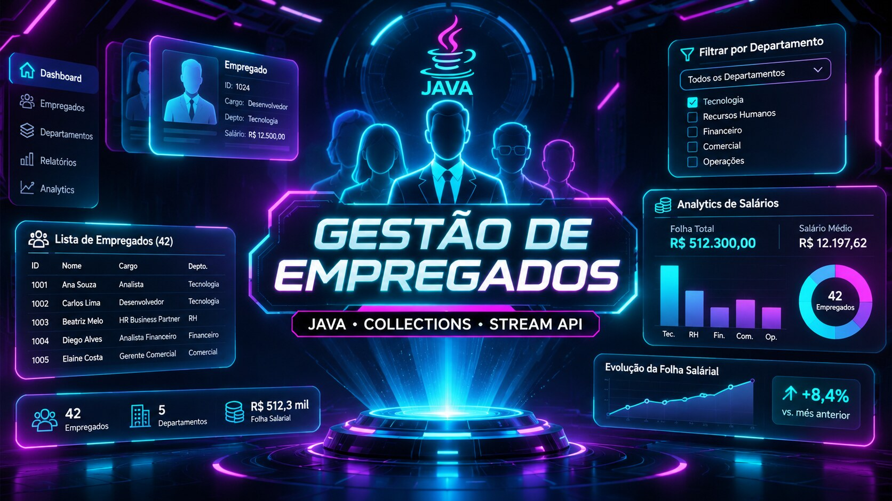
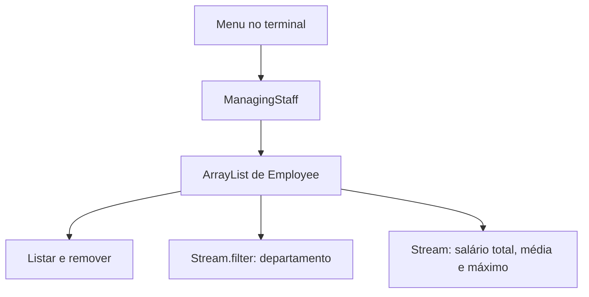

<div align="center">
  
</div>

<div align="center">

# G E S T Ã O　D E　E M P R E G A D O S

### `JAVA • POO • COLLECTIONS • STREAM API`

**Sistema de terminal para cadastro, consulta, remoção e análise de empregados em Java.**


`FATEC • ADS` · `JAVA CORE` · `PROJETO ACADÊMICO`

[Visão geral](#visao-geral) · [Funcionalidades](#funcionalidades) · [Arquitetura](#arquitetura) · [Execução](#execucao)

</div>

---

<a id="visao-geral"></a>

## `PROJECT // VISÃO GERAL`

O **GestaoEmpregados.java** é uma aplicação de console criada para praticar orientação a objetos, listas e Java Streams. O projeto mantém empregados com **nome, sobrenome, salário e departamento**, incluindo quatro registros iniciais para demonstração.

As operações utilizam uma `ArrayList<Employee>` e permanecem **apenas na memória**; não há API REST, interface web ou banco de dados.

<a id="funcionalidades"></a>

## `SYSTEM // FUNCIONALIDADES`

| Menu | Operação |
| :---: | :--- |
| `1` | Listar todos os empregados |
| `2` | Filtrar empregados por departamento, ignorando maiúsculas/minúsculas |
| `3` | Cadastrar empregado com validação de campos e salário |
| `4` | Remover empregado pelo número da lista |
| `5` | Calcular total da folha, média salarial e maior salário |
| `0` | Sair |

### `JAVA CORE // REGRAS`

- Cada empregado é representado pela classe `Employee`, com atributos privados e getters/setters.
- O filtro usa `stream().filter()` e `equalsIgnoreCase()`.
- A análise salarial utiliza `mapToDouble()`, `sum()`, `average()` e `max()`.
- O cadastro rejeita nomes ou departamento vazios e salários negativos ou não finitos.
- Os dados inseridos durante a execução não ficam salvos após sair do programa.

<a id="arquitetura"></a>

## `ARCHITECTURE // FLUXO`



## `STRUCTURE // DIRETÓRIOS`

```text
GestaoEmpregados.java/
├── src/
│   ├── controller/
│   │   └── ManagingStaff.java
│   └── model/
│       └── Employee.java
├── docs/
│   └── modulo02.pdf
└── README.md
```

| Arquivo | Responsabilidade |
| :--- | :--- |
| [`ManagingStaff.java`](src/controller/ManagingStaff.java) | Menu, operações e consultas por Stream |
| [`Employee.java`](src/model/Employee.java) | Modelo com atributos e exibição formatada |
| [`modulo02.pdf`](docs/modulo02.pdf) | Material acadêmico da atividade |

<a id="execucao"></a>

## `BOOT SEQUENCE // EXECUTAR NO LINUX`

**Pré-requisito:** JDK 17 ou superior.

```bash
git clone https://github.com/gilbertocorrea-cmd/GestaoEmpregados.java.git
cd GestaoEmpregados.java
mkdir -p out
javac -d out src/model/Employee.java src/controller/ManagingStaff.java
java -cp out controller.ManagingStaff
```

O programa inicia com quatro empregados de exemplo, e você pode cadastrar mais pelo menu.

## `LEARNING // CONCEITOS`

`Classes` · `Encapsulamento` · `Getters/Setters` · `ArrayList` · `Stream` · `filter` · `mapToDouble` · `sum` · `average` · `Comparator` · `Scanner` · `switch` · `try/catch`.

---

<div align="center">

### `STAFF MANAGEMENT // CODE • LEARN • EVOLVE`

**Gilberto Corrêa** · Análise e Desenvolvimento de Sistemas — FATEC

[GitHub](https://github.com/gilbertocorrea-cmd)

</div>
